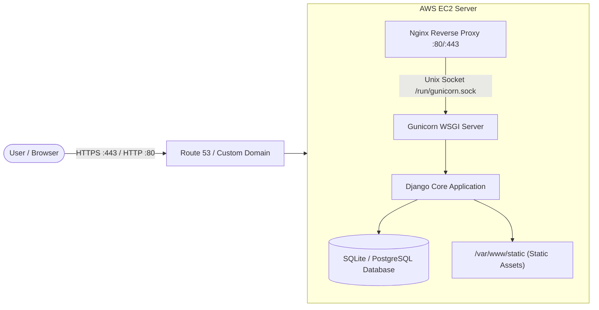

# Deploy Django on AWS EC2 with Nginx, Gunicorn & SSL in 5 Minutes

A battle-tested production blueprint and automation toolkit to deploy **Django** applications to an **AWS EC2 Ubuntu Server** using **Nginx** reverse proxy, **Gunicorn** WSGI application server with systemd socket activation, and free **Let's Encrypt SSL (HTTPS)**.

[](https://github.com/codewithmuh/django-aws-ec2-nginx-gunicorn/releases)
[](https://github.com/codewithmuh/django-aws-ec2-nginx-gunicorn/stargazers)
[](https://github.com/codewithmuh/django-aws-ec2-nginx-gunicorn/network/members)
[](LICENSE)
[](https://python.org)
[](https://djangoproject.com)
[](https://aws.amazon.com/ec2)
[](https://youtube.com/@codewithmuh)
[](https://www.linkedin.com/in/muhammadrashid-daha/)

📺 **Full YouTube Video Tutorial:** https://youtu.be/KItpu15ZmkY


---

## 📑 Table of Contents
- [Architecture & Request Flow](#architecture--request-flow)
- [Repository File Catalog](#repository-file-catalog)
- [Prerequisites & Security Group Rules](#prerequisites--security-group-rules)
- [Method 1: 1-Click Automated Setup (UserData.sh)](#method-1-1-click-automated-setup-userdatash)
- [Method 2: Step-by-Step Manual Deployment](#method-2-step-by-step-manual-deployment)
  - [1. Connect and Clone](#1-connect-to-ec2-and-clone)
  - [2. Install OS & Python Dependencies](#2-install-os-and-python-dependencies)
  - [3. Configure Gunicorn Systemd Units](#3-configure-gunicorn-systemd-service--socket)
  - [4. Configure Nginx Reverse Proxy](#4-configure-nginx-reverse-proxy)
  - [5. Setup SSL via Certbot](#5-setup-domain--free-ssl-certbot)
- [Troubleshooting & Logs](#troubleshooting--logs)
- [Author & Community](#author)
- [License](#license)

---

## 🏛️ Architecture & Request Flow



---

## 📂 Repository File Catalog

| Path | Purpose |
| :--- | :--- |
| `UserData.sh` | EC2 launch bootstrap script for completely automated deployment on first boot. |
| `gunicorn/gunicorn.service` | Systemd service unit managing Gunicorn workers and environment. |
| `gunicorn/gunicorn.socket` | Systemd socket activation unit for `/run/gunicorn.sock`. |
| `nginx/nginx.conf` | Optimized Nginx virtual host with proxy headers and static asset routing. |
| `scripts/instance_os_dependencies.sh` | Installs system packages: `python3-pip`, `python3-venv`, `libpq-dev`, `nginx`, `curl`. |
| `scripts/python_dependencies.sh` | Creates Python virtual environment and installs `requirements.txt`. |
| `scripts/gunicorn.sh` | Copies and enables Gunicorn systemd socket and service units. |
| `scripts/nginx.sh` | Configures and links Nginx virtual host file. |
| `scripts/start_app.sh` | Applies migrations, collects static assets, and starts the services. |

---

## 🛡️ Prerequisites & Security Group Rules

Configure your EC2 Security Group with the following **Inbound Rules**:

| Type | Port | Source | Description |
| :--- | :--- | :--- | :--- |
| **SSH** | `22` | `My IP` | Secure remote shell access |
| **HTTP** | `80` | `0.0.0.0/0` | Web traffic and Let's Encrypt ACME verification |
| **HTTPS**| `443` | `0.0.0.0/0` | Secure encrypted web traffic |

---

## ⚡ Method 1: 1-Click Automated Setup (UserData.sh)

When launching an **Ubuntu 22.04 LTS or 24.04 LTS** EC2 instance, expand **Advanced details** in the AWS Console and paste `UserData.sh` into the **User data** box.

Your Django app will automatically clone, install dependencies, configure Gunicorn and Nginx, and go live immediately upon instance startup!

---

## 🛠️ Method 2: Step-by-Step Manual Deployment

### 1. Connect to EC2 and Clone

```bash
ssh -i your-key.pem ubuntu@<EC2-PUBLIC-IP>

# Clone this repo into /home/ubuntu/
git clone https://github.com/codewithmuh/django-aws-ec2-nginx-gunicorn.git
cd django-aws-ec2-nginx-gunicorn
chmod +x scripts/*.sh
```

### 2. Install OS and Python Dependencies

```bash
./scripts/instance_os_dependencies.sh
./scripts/python_dependencies.sh
```

### 3. Configure Gunicorn Systemd Service & Socket

```bash
./scripts/gunicorn.sh
sudo systemctl status gunicorn.socket
```

### 4. Configure Nginx Reverse Proxy

```bash
./scripts/nginx.sh
./scripts/start_app.sh
```

### 5. Setup Domain & Free SSL (Certbot)

```bash
sudo apt install -y certbot python3-certbot-nginx
sudo certbot --nginx -d yourdomain.com -d www.yourdomain.com
```

---

## 🔍 Troubleshooting & Logs

```bash
# Check Gunicorn service status & logs
sudo systemctl status gunicorn
sudo journalctl -u gunicorn -n 50 --no-pager

# Check Nginx syntax & status
sudo nginx -t
sudo systemctl status nginx

# View Nginx access & error logs
sudo tail -f /var/log/nginx/error.log
sudo tail -f /var/log/nginx/access.log
```

---

## 👨‍💻 Author

**Muhammad Rashid** — Backend & Cloud DevOps Engineer, AWS Community Builder.  
- 🎥 **YouTube:** [@codewithmuh](https://youtube.com/@codewithmuh)  
- 💼 **LinkedIn:** [Muhammad Rashid](https://www.linkedin.com/in/muhammadrashid-daha/)  
- 🌐 **Website:** [codewithmuh.com](https://codewithmuh.com) · [devopsbymuh.com](https://devopsbymuh.com)

⭐ **If you find this deployment repository helpful, please star it!**

---

## 📄 License

This repository is distributed under the [MIT License](LICENSE).
